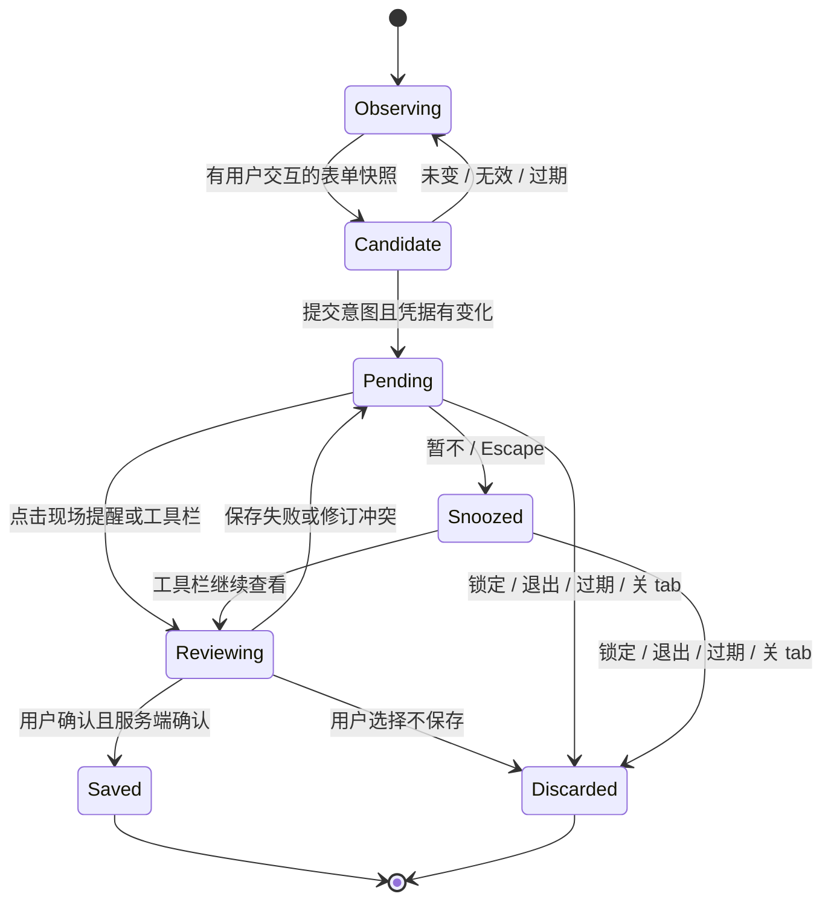

# 浏览器密码生成、保存与更新

状态：设计稿，待用户确认后编写实施计划；尚未修改产品代码。

## 目标与范围

用户要求：登录时发现输入密码与已保存记录不一致，应提示是否更新；注册密码框附近提供简易随机密码生成器；注册提交后提示新增登录条目。先调研 1Password，再完成设计，随后实施。完成实现与验证后按用户既有要求提交、推送。

本次针对 Chrome、Edge、Firefox 扩展。覆盖普通登录、注册、修改密码、同一来源下的分步登录、页面跳转和 SPA 提交。沿用现有 TypeScript、扩展后台、共享保险库界面和加密库，不增加服务端接口。桌面和移动端继续使用既有共享生成器，不在本次扩展系统自动填充能力。

成功标准：用户不用记得打开工具栏才知道有密码待保存；同一账号的未变密码不打扰；不会因账号判断含糊而覆盖其他记录；生成并使用的密码即使漏点保存，之后仍能找回。

下文标为“设计选择”的默认行为由本次设计提出，尚不代表用户逐项确认。

## 调研依据与现状

本次依据 1Password 官方公开说明与本项目代码，未声称实测 1Password 的内部实现。

| 证据 | 观察 | 对本项目的影响 |
| --- | --- | --- |
| [1Password：保存与填充](https://support.1password.com/save-fill-passwords/) | 登录后提供保存；注册密码框提供建议密码，也能打开自定义生成器 | 自动出现的现场入口是主体验，工具栏作为补充 |
| [1Password：更换密码](https://support.1password.com/generate-website-password/) | 新密码字段可生成；保存时能改选要更新的登录条目；文档流程允许先更新密码库，再在网站提交 | 不能把“密码库已保存”当作“网站已修改成功”；必须能检查更新对象 |
| [1Password：找回未保存的生成密码](https://support.1password.com/recover-unsaved-password/) | 生成器用于填入网站的密码有历史可查 | 已使用的生成密码需要独立的恢复途径 |
| `packages/vault/src/credential-capture.ts` | 已比较站点、用户名、密码，返回保存、更新或无变化；含“首条空用户名”的猜测 | 保留比较基础，消除歧义时默认覆盖的行为 |
| `apps/desktop/extension/background.ts` | 提交后才异步注入取值；待保存数据按 tab 存在 session；提示是角标和 popup 中的卡片 | 导航可能先清空表单；需要及时快照、现场通知和明确的 capture ID |
| `packages/vault/src/form-fields.ts` | 单个密码框被视为当前密码；部分用户名启发式跳过非空字段；按整页字段分类 | 补齐注册语义、已输入用户名与表单分组，避免多表单串值 |
| `apps/desktop/extension/inline-picker.ts`、`fill.ts` | 已有输入框附近的账号选择器、真实点击检查、框架兼容填值；当前仅顶层页面 | 复用样式、定位和填值机制，并为本次捕获/生成明确绑定表单、frame 与 document |
| `packages/crypto/src/generator.ts`、`packages/ui/src/Generator.tsx` | 已有安全随机密码算法和完整生成器 | 复用算法；附近的小面板只提供常用设置 |
| `packages/vault/src/client.ts` | 保存已有修订版本检查、密码历史和元数据保留 | 更新走既有保存链路，避免再造历史和覆盖整条旧快照 |

## 方案比较

1. **推荐：现场生成与提醒，扩展界面最终保存。** 输入框附近生成密码，提交后页面角落出现提示；点击“检查并保存/更新”打开可信扩展界面完成确认。复用现有权限边界和共享 UI，多一个确认动作换来清晰的账号、目标条目与错误处理。
2. **全部在网页浮层直接保存。** 操作少一步，但需要新增可以从页面触发写入保险库的授权路径，或额外的扩展来源 iframe UI；本次不选。
3. **只加强工具栏角标。** 改动少，但用户仍会漏掉保存请求，也不满足输入框附近生成器的要求；不选。

## 用户流程

### 登录与更新

用户正常输入或自动填充账号密码。输入过程中不弹“是否更新”，只维护当前表单的短期候选；提交时再比较。密码完全相同不提示。唯一确定的已存账号密码不同，出现“更新已保存的密码？”；未找到对应账号，出现“保存这次登录？”；不能确定目标时，出现“检查这次登录信息”，由用户选“新增”或明确选择更新对象。

提醒只显示来源站点、用户本次输入的账号和动作，不显示新旧密码。按钮为“检查并更新/保存”和“暂不”；关闭和 Escape 等同“暂不”。点击检查后打开现有扩展界面，展示捕获来源、当前保险库账号、新增/更新选择和目标条目；用户最后点击“保存”或“更新密码”。网站脚本不能直接调用最终写入接口。

更新默认仅修改密码；不擅自替换标题、网址、用户名、TOTP、Passkey、附件或自定义字段。原条目没有用户名时，用户在确认界面可以选择补上本次用户名。选择一个不同用户名的条目必须显示清晰的目标账号，不自动更名。旧密码由现有保存服务加入历史。

### 注册与生成

聚焦注册的密码框或修改密码页的“新密码”框时，在输入框边缘显示 1Warden 入口，并在下方显示“使用随机密码”；和已有账号选择面板共用定位及关闭规则，避免两个浮层叠加。普通登录密码框保留账号建议，生成器只作为用户主动展开的次要入口。

设计选择：默认 20 位，大写、小写、数字、符号；展开后可调整 8–64 位长度、数字、符号，字母默认保留。需要全部字符类别开关、口令模式或超出简易范围的规则时，打开已有完整生成器。附近面板展示掩码与长度，不向常驻界面返回生成密码明文；用户点击“生成并填入”才生成，点击“重新生成并填入”才换值，修改设置本身不覆盖表单。

生成值填入当前新密码框和同组确认密码框，不动旧密码、其他表单或其他 frame。已由本生成器填入的值可再次替换；若用户已手动改写或原本存在内容，先在附近面板明确确认“替换当前输入的密码”。填入后派发框架需要的 input/change 事件并读回核验。只读、隐藏、禁用或已脱离文档的字段不填。

优先遵守两个目标字段的 minlength/maxlength 交集；与 8–64 位无交集时不截断、不强填，引导完整生成器。原生 pattern 能检查时验证候选，失败则提示调整设置；不承诺自动理解所有网站脚本规则。确认框两次输入不一致时，不把其中任意一个视为可保存凭据。

填入前先加密保存一条本机生成历史，随后显示“已填入；提交后可保存登录信息”。注册提交后提示“保存这次登录？”。若同站已有相同用户名，默认进入检查界面说明“已有同名账号”，允许明确选择更新或另存，不无声覆盖。网站报告失败时，用户可暂不保存；最终界面不声称注册已成功。

### 修改密码

区分旧密码、新密码、确认密码，只生成和捕获新密码。原账号有明确匹配则提示更新，否则让用户选择目标。已保存到保险库不意味着网站已接受；确认界面保留“请确认网站已接受此密码”的简短说明。恢复旧密码使用已有密码历史。

### 找回、失败与锁定

扩展生成器增加“已使用的生成密码”入口，展示本机时间与来源站点；解锁后可显式查看、复制、删除，或进入保存检查流程。历史与正式登录条目分开，不出现在正常登录列表，不自动同步成登录。

设计选择：历史按保险库账号隔离、加密保存，保留最近 30 天且最多 100 条；每次真实使用保留独立记录，重新生成不会立即丢掉前一个值。预览和仅修改选项不生成历史。锁定、自动锁定和浏览器重启后加密历史仍在，必须用原账号解锁；退出账号清理该账号的本机历史，切换账号隐藏但不删除原账号历史。达到上限时按时间淘汰，界面说明保留范围。

保险库锁定时附近入口显示“解锁后生成”，不先生成一个无法保护的密码。解锁后用户再次点击生成；不自动把解锁前排队的填入或保存请求续跑。普通手工输入的待保存密码只保留在当前解锁会话，不持久化到磁盘；因锁定未捕获时，可以解锁后重新提交或在扩展中手动新增。

网络保存失败保留待处理信息和可重试按钮，不显示“已保存”；修订冲突先刷新目标，让用户重新确认，绝不覆盖远端较新记录。重复点击或重放同一 capture ID 不创建重复条目。返回成功后立即移除对应提醒并刷新匹配结果。

## 识别与判定规则

- 先按实际 form 元素分组，包括通过 form 属性关联的控件。无 form 的页面以已交互密码框及其最近的语义容器为组；组内有多个无法区分的候选时不跨组猜测，提供手动检查入口。
- autocomplete 的 token 识别优先于 name、id、关联 label、placeholder 和按钮语义。`new-password` 即使只有一个框也识别为新密码；`current-password` 不因页面出现“注册”链接而改判。
- 没有显式提示时，结合密码/确认字段及同组注册、改密按钮判定；仍含糊的单密码表单按登录处理，同时允许主动生成。OTP、搜索、付款验证码、主密码解锁框等不归为网站新密码。
- 对关联标签、aria-labelledby、非空用户名、邮箱和先用户名后密码的场景做覆盖。分步用户名仅在同一 tab、同一 origin 内保留 5 分钟，只有真实用户名阶段提交可建立；后续明确输入优先，跨 origin 不继承。
- 用户切换“显示密码”后，仅对同一文档内已经识别的密码控件或显式 password autocomplete 保留角色，不因任意 text 控件名称带 password 就捕获它。
- 新旧密码按原值精确比较，不 trim 或改变大小写。空值与明显掩码不能作为新密码；用户名只清理首尾空白，不把大小写不同的账号强行合并。
- 站点候选复用 `matchItemsByUrl`，保留 HTTPS 降级限制、私有域名边界、Never 规则，排除归档和回收站。
- 登录表单：唯一同用户名匹配才默认推荐更新；若多个同用户名记录中已有完全相同的密码，不打扰，也不把其他副本自动改成它。没有同用户名匹配时默认新增。
- 缺用户名时不再选择第一条空用户名记录；可以用本次用户明确选择并填充的条目 ID 建议目标，但必须仍满足来源、会话、表单绑定。没有这种依据则由用户选择，即便站内只有一条也不自动决定覆盖。
- 注册/改密表单意图参与最终判定。多条同名记录且密码均不同、无用户名等情况进入“检查”，明确选择之前没有默认更新对象。

## 捕获、通知与生命周期

现有“提交后后台才注入读取”会输给导航和清空表单。设计选择：增加在 ISOLATED world、document_start 安装的专用捕获模块，在用户触发的 change/失焦以及提交意图发生时，直接读取当前表单的必要值，立即通过扩展 runtime 消息交给后台。输入的高频变更只用于标记候选已失效，不逐键读取、比较或发送密码。可信点击/Enter 的捕获阶段在网站清空前刷新候选，submit 再确认；相同候选去重。

这是对旧注释“任何 content script 都不接触明文”的有意收窄：仅专用捕获模块在事件处理时短暂接触用户已经交给该网页的表单值；账号选择器、生成器界面、页面通知仍不接收保险库秘密。禁止把捕获密码放入 window.postMessage、DOM 属性、日志、异常信息、浏览器 URL 或 localStorage；不向 MAIN world 暴露回调。后台只能向捕获方返回无秘密的状态。

真实 submit 是主要提交信号。无 form 的 SPA 可用同组明确的登录/注册/改密按钮和 Enter 作为提交意图；单独 pagehide、字段失焦、移除或 URL 变化都不能把尚未提交的输入升级成待保存。脚本触发的 submit 需要该表单近期真实用户交互，避免任意脚本批量造提醒。网站校验失败不能被统一、可靠地探知，因此通知始终用“检测到本次提交”，不写“登录/注册成功”。不拦截网络响应，不阻断网站提交。

设计选择：候选快照有效 2 分钟；正式待处理有效 30 分钟，且不超过当前解锁会话。每 tab 最多 3 个待处理项，按表单/来源/用户名分别保留；同表单同账号的新提交替换未保存的旧候选，不同账号是独立项，重复事件合并。满额时保留最新 3 个并在可信界面说明，已使用生成密码仍有独立历史。暂不只关闭本次自动提醒，不丢弃待处理；工具栏“不保存”才删除。相同候选不再自动弹出，新密码或新一次明确提交可产生新提醒。空值、确认不一致或另一个账号的无变化提交不得清除其他待处理项。

页面初始化向后台请求可显示的待处理提醒，因此普通导航和 SPA 重渲染后都能恢复。同源新页面显示一次非模态角落卡片，不抢输入焦点；跨来源跳转只保留工具栏待办，在新来源页面不显示旧站账号或站点信息。手动展开扩展可继续处理原始来源的待办。

## 来源与权限边界

- 每个请求使用浏览器提供的 sender.id、tab.id、frameId、url/origin；不以载荷自报 URL 作为站点授权。捕获 ID 为后台生成的随机标识。
- 所有来自网页的候选、生成操作、提醒、保存请求绑定账号、解锁代次、tab、frame、document 和 form。Chromium 有 documentId 时优先使用；不支持时用 isolated world 的文档随机 nonce，并在注入执行时重新核验，不能只比较 URL。
- 顶层与同源 iframe 支持附近生成、捕获、提醒；iframe 中的提醒留在该 frame 内，不能把内容错误归给另一表单。跨域 iframe 本次不自动读取、生成或提供账号建议，工具栏可手动使用生成器和新增条目；about:blank/srcdoc、沙箱不透明来源、浏览器特权页同样不自动处理。现有 WebAuthn 流程不受影响。
- 生成与填值由后台执行。请求只带设置和目标标识；后台重新验证目标类型、可见性、min/max、同组确认框、当前文档和解锁状态。先成功写入加密历史，再注入新密码并核验；页面变动或锁定后取消。
- 新增内容脚本请求仅能提交本站候选、生成并填入当前新密码位置、获取本站通知概要、暂不显示、打开检查 UI。它们没有读取待保存明文、枚举历史、读取旧密码或提交保险库写入的权限。
- 最终保存继续限定为可信的扩展页面 RPC；检查界面使用 captureId 和当前账号校验，不能靠 tabId 保存“碰巧最新的”另一份凭据。ID 和预览版本必须对应用户刚看到的内容，更新后的候选要求重新预览。
- 已捕获的待办保留原始文档身份作为来源证据；导航后在可信界面保存不要求原文档继续存活，只有再次读取/填入网页才要求实时文档一致。从生成历史恢复则使用独立的 historyId 和来源类型，绑定当前解锁账号，不依赖已关闭的 tab。历史记录没有用户名时，在检查界面补充或明确选择已有条目；保存请求不能把历史 ID 当作网页填入授权。
- openPopup 受浏览器能力或手势限制失败时，从真实点击回退打开自有扩展页面的检查视图；地址只含随机 capture ID。不可自动打开任意外部 URL，也不可在没有点击时反复开窗口。
- 页面上的 shadow DOM 是样式和交互隔离手段，不当作安全边界。界面控制只接受真实用户操作；所有权限仍由后台复查。异步每一步都检查会话代次，锁定后旧结果不能复活。

## 数据与模块

| 数据 | 存储与边界 | 清理 |
| --- | --- | --- |
| 文档/表单标识、是否已交互 | 捕获模块内存，无密码缓存 | 文档结束 |
| 候选快照、分步用户名 | 后台受信任 session，绑定来源与解锁代次 | 2/5 分钟、关 tab、锁定、退出 |
| 待确认捕获 | 受信任 session；ID、revision、来源、账号、时间、表单意图、用户名、密码、建议操作 | 保存、不保存、30 分钟、关 tab、锁定、退出 |
| 已使用生成密码历史 | 本机 extension storage.local 的加密封装；账号隔离，使用现有加密原语 | 30 天/100 条、用户删除、退出账号 |
| 提醒概要 | content UI，只含必要展示文字、capture ID 和动作 | 关闭、导航、锁定或捕获失效 |

加密历史使用现有经过认证的 `encryptString/decryptString` 与账号密钥。加密载荷包含用途标识、版本、所属账号、记录 ID、创建时间、来源站点和密码；解密后校验这些字段，防止跨账号或跨用途混用。索引不保存明文用户名或密码；查询时只解密当前解锁账号。不可自行发明加密算法，也不可把密钥写入 local。写入失败不执行生成密码填入。

建议模块拆分：

- vault 纯逻辑：表单角色与意图、账号匹配和 capture decision；可独立单测。
- 扩展 `credential-observer`：document_start 事件捕获、表单分组和短暂传输。
- 扩展 `capture-service`：候选状态、去重、超时、账号/文档校验、预览及确认保存；从现有大型 background 文件抽出与本任务有关的逻辑。
- 扩展 `generated-password-store`：加密历史、保留策略和显式恢复；复用 crypto generator。
- 扩展 inline UI：复用现有定位、键盘、主题，添加生成设置与通知，不引入另一个 UI 框架。
- 共享 UI 的浏览器能力插槽：检查捕获、选择新增或更新、生成历史入口；桌面/移动端无浏览器能力时不显示。

最终保存基于最新条目，仅合并用户确认的密码等字段，保留原条目其他数据，交给 VaultClient 处理历史和服务端修订冲突。写入前再做无变化/重复判断。同一 capture ID 共用执行结果；本地已知成功后关闭 popup 不会导致重建。服务端新建请求结果不明时先同步并查找来源、用户名、密码一致的结果；不能确认时提示检查，不盲目自动重试新建。

## 验收与实施顺序

| 场景 | 必须结果 |
| --- | --- |
| 已存账号 + 相同密码 | 无新增/更新提醒 |
| 已存唯一账号 + 不同密码 | 提示更新；未确认不写；确认后保留旧密码历史及其他字段 |
| 新账号、缺用户名、多账号、同名重复 | 推荐新增或明确选择，绝不取第一条覆盖 |
| 注册只有一个 new-password、双密码确认、旧/新/确认三框 | 角色正确；只填/存新密码；不一致不保存 |
| 登录和注册在同页、隐藏诱饵、非空用户名、OTP、密码可见切换 | 不串组、不存验证码，不漏掉有效账号 |
| 生成后重生成、手改后再点生成 | 历史可恢复；手改值覆盖前有明确确认 |
| 表单点击、Enter、JS SPA、立即导航、同源下一页 | 捕获本次凭据；导航后有提醒；失败提示不冒称成功 |
| 多步骤登录、跨来源跳转、同源/跨域 frame | 按上述来源范围工作，跨来源不继承用户名或显示旧站数据 |
| 锁定、账号切换、SW 重启、tab 关闭、超时 | 待处理遵守生命周期，旧请求不写进新会话；加密历史按账号恢复 |
| 保存失败、修订冲突、重复点击、响应丢失 | 能恢复处理，不丢新密码，不重复创建或覆盖较新记录 |
| 伪造页面消息、伪造 URL/ID、过期 document、跨账号请求 | 被后台拒绝，内容脚本读不到旧密码/历史/密钥 |
| 主题、窄窗口、缩放、键盘与屏幕阅读器 | 不遮挡关键表单操作；Tab/Escape 可用；错误通过 status/alert 宣告 |

先落实表单分类、捕获判定和来源约束的测试，再实现捕获状态服务与提交提醒，然后接入附近生成器及加密恢复历史，最后完成可信界面的新增/更新选择和实际浏览器流程。

验证包括相关单测、TypeScript、Chrome/Firefox 扩展构建，以及共享前端的桌面/移动构建回归；用项目已有浏览器测试工具跑本地合成站点（普通跳转、SPA、多表单、同源 frame、错误提交）。不得用真实用户账号进行注册或改密测试。浏览器实测覆盖与仅通过构建的范围分别报告，不把构建成功说成实机验证。

## 设计自查

- 提交是意图而非网站成功证明；所有正式新增/更新均显式确认。
- 生成历史解决漏保存和浏览器重启后的找回，正式条目不提前改写。
- 手工捕获的隐私期限、生成历史的恢复期限、锁定和退出行为分别定义。
- 页面现场交互与可信扩展写入分离；短暂读取表单值的边界调整已明确说明。
- 本次不新增远端密码规则库、站点专属脚本、推送服务、平台商店发布或移动系统自动填充。
- 已按 Superpowers 的 builder-check 流程做只读独立审查，结论为没有影响制定实施计划的未决问题；上述默认取舍仍需用户确认。
